# Endgame implementation flowcharts

These diagrams describe the code that is currently implemented in Endgame. They are written in Mermaid so GitHub, VS Code Mermaid extensions, and other Mermaid-capable documentation viewers can render them directly.

Open [current-implementation.md](current-implementation.md) for the detailed process diagrams.

## Reading the diagrams

| Shape or style | Meaning |
|---|---|
| Rounded rectangle | User or system action |
| Diamond | Rule, authorization, or validation decision |
| Green node | Successful state or completed operation |
| Red node | Rejected, unavailable, or failed operation |
| Dashed line | A later operational dependency rather than an application action |

## Current scope

```mermaid
flowchart LR
    P01["P01: Accounts & authentication\nImplemented"]:::implemented
    P02["P02: Projects & access\nImplemented"]:::implemented
    P03["P03: Ticket management\nNot implemented"]:::future
    P04["P04: Workflows\nNot implemented"]:::future
    P05["P05: Kanban & backlog\nNot implemented"]:::future
    P06["P06: Structured tickets\nNot implemented"]:::future
    P07["P07: Collaboration\nNot implemented"]:::future
    P08["P08: Dashboards\nNot implemented"]:::future

    P01 --> P02 --> P03 --> P04 --> P05 --> P06 --> P07 --> P08

    classDef implemented fill:#e8f5ee,stroke:#23825b,color:#173e2e,stroke-width:1.5px;
    classDef future fill:#f5f3f0,stroke:#aaa39a,color:#655f58,stroke-dasharray: 5 4;
```

P01 supplies active, authenticated accounts. P02 uses those accounts to control project membership and permissions. The later modules require separate approved designs and have not been added to the application.
