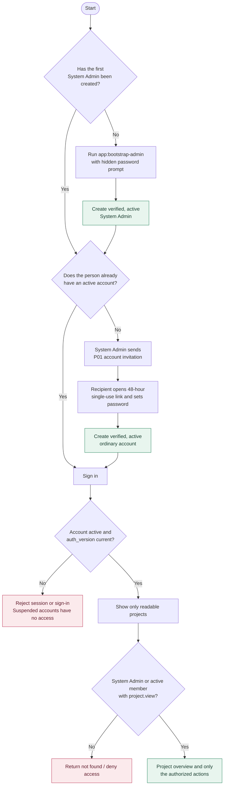
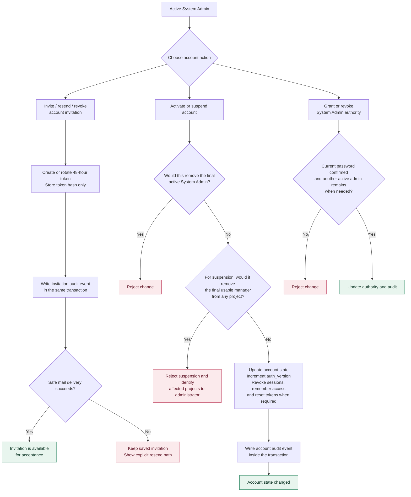
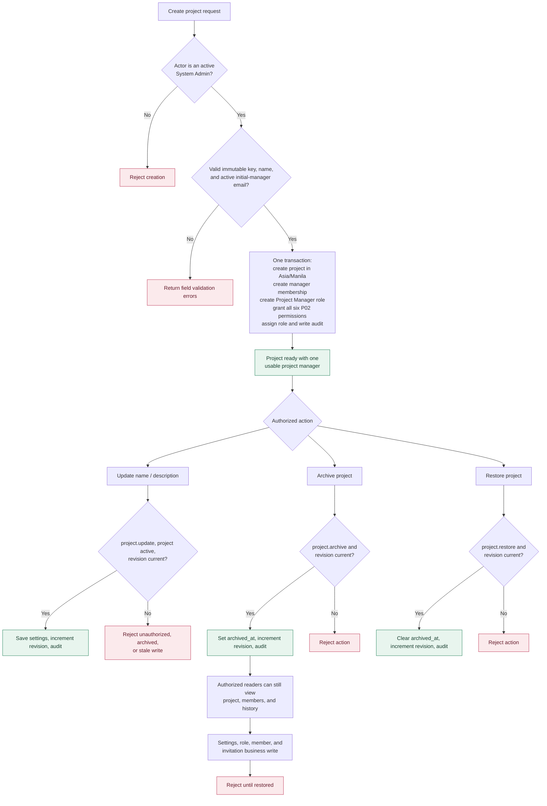
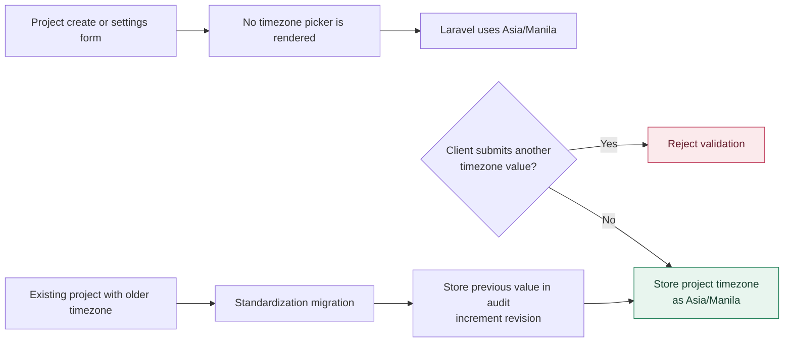
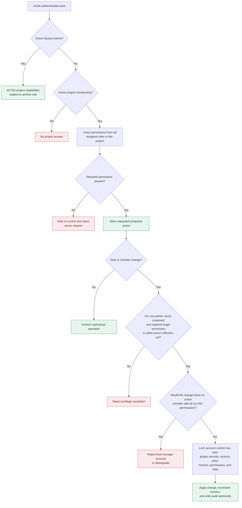
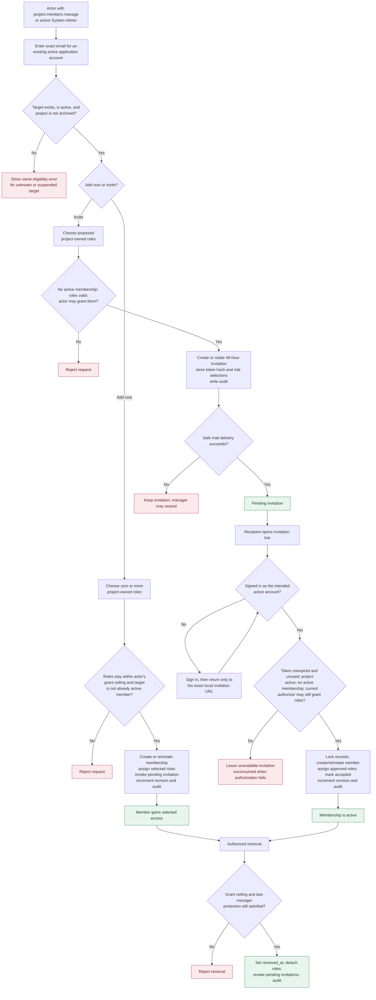
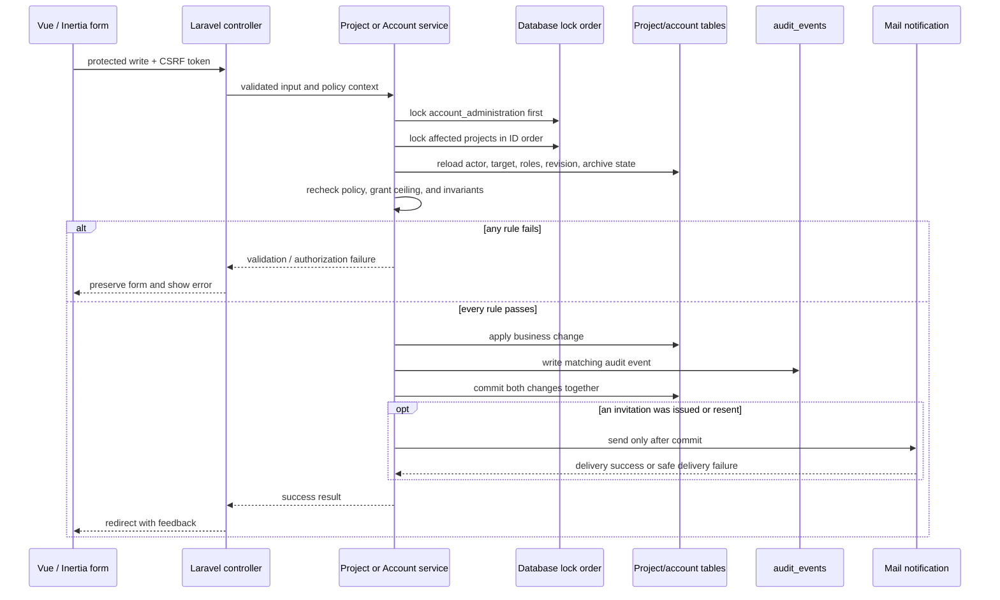
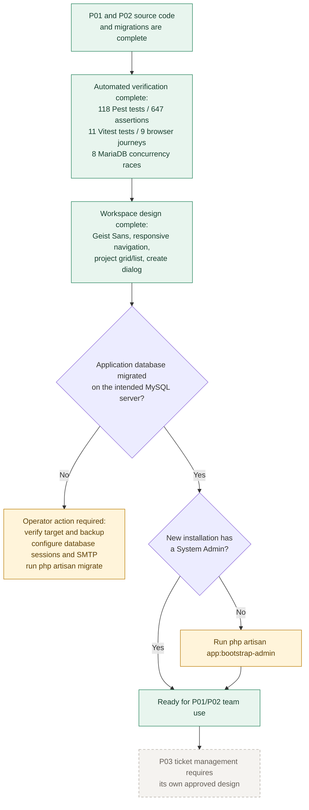

# Current implementation process flow

**Last updated:** 2026-10-22  
**Implemented scope:** P01 accounts and authentication; P02 projects, members, roles, permissions, and invitations.

The diagrams below reflect the implemented server rules. Vue/Inertia screens can hide unavailable controls, but Laravel policies and transactional service checks decide every protected operation.

## 1. End-to-end access path

## 2. Account administration and security lifecycle (P01)

## 3. Project creation, visibility, and lifecycle (P02)

### Fixed timezone rule

Application timestamps remain stored in UTC; project-facing dates are displayed in `Asia/Manila`.

## 4. Project permissions, roles, and membership changes

The six implemented P02 permissions are `project.view`, `project.update`, `project.members.manage`, `project.roles.manage`, `project.archive`, and `project.restore`. Membership and a role name alone grant nothing.

## 5. Direct addition, removal, and project invitation lifecycle

## 6. Write integrity and audit boundary

No raw invitation token, token hash, password, session payload, or mail transport exception is placed in audit metadata or Inertia page props.

## 7. Implementation and operator status

The isolated test migrations and retained MariaDB test schemas do not migrate the application database. Live SMTP delivery and execution on an actual MySQL server remain operator verification steps.
